# ARVEN — Database Architecture & Data Model Specification

> **Engine & ORM Pin:** PostgreSQL `18.x` + **Prisma ORM 7 GA** (`prisma@^7`, `@prisma/client@^7`, `@prisma/adapter-pg`, `pg`).  
> **Configuration Standard:** Configured via `packages/database/prisma.config.ts` (`defineConfig`, `env`, `import 'dotenv/config'`) and instantiated with `new PrismaClient({ adapter: new PrismaPg({ connectionString }) })`.  
> **Prohibited Patterns:** Prisma 8 RC (`8.0.0-rc.29+`, `contract.prisma`, `@prisma/orm-postgres/config`) and legacy Prisma 5/6 `datasource db { url = env("DATABASE_URL") }` inside `schema.prisma` are strictly forbidden ([ADR-001](./adr/ADR-001-tech-stack-and-version-pins.md)).

---

## 1. Ambiguity Resolutions Locked (`AMB-01`..`AMB-06`)

| ID | Blueprint Discrepancy | Canonical Resolution Locked Here |
|---|---|---|
| `AMB-01` | Blueprint 5.1 includes `READY_TO_PUBLISH` while 10.6 omitted it | `ProductStatus` enum **includes `READY_TO_PUBLISH`**: `DRAFT`, `REVIEW`, `READY_TO_PUBLISH`, `PUBLISHED`, `ARCHIVED` |
| `AMB-02` | Blueprint 10.2 wrote `on_hand, reserved`; 12.1 SQL wrote `quantity_on_hand, quantity_reserved` | Physical columns standardized as **`quantity_on_hand`** and **`quantity_reserved`** on `inventory_levels` (mapped cleanly in Prisma via `@map`) |
| `AMB-03` | Blueprint 5.2 wrote `COMMIT/SALE`; 10.6 enum wrote `SALE` | Canonical `InventoryMovementType` enum value is **`SALE`** |
| `AMB-04` | Blueprint 20.3 supports guest checkout; 10.2 omitted nullability on `Order.user_id` | `orders.user_id` is **nullable** (`UUID NULL`), paired with `guest_email`, `guest_token_hash`, and `CHECK` enforcing either `user_id IS NOT NULL` or guest fields present |
| `AMB-05` | Same-site session cookies across apps | `sessions` stores hashed session token, separate portal scope (`CUSTOMER` / `ADMIN`), CSRF secret salt, and `mfa_verified_at` ([ADR-002](./adr/ADR-002-session-proxy-and-same-site-auth.md)) |
| `AMB-06` | `RefundStatus`, `CouponType`, `CartStatus`, `StockReservationStatus` referenced in prose without enum rows | All four defined explicitly in Section 3 (`RefundStatus`, `DiscountType`, `CartStatus`, `StockReservationStatus`), plus supporting enums |

---

## 2. Monetary, Temporal & Deletion Rules

1. **Monetary Precision (Integer IDR):**
   - All monetary values (prices, discounts, shipping fees, taxes, totals, payments, refunds) MUST be stored as **signed 64-bit integer Rupiah (`BIGINT`)** in PostgreSQL (mapped to `BigInt` in Prisma, validated at API boundaries within safe JSON integer bounds `0 <= n <= Number.MAX_SAFE_INTEGER`).
   - **Never** use `FLOAT`, `DOUBLE PRECISION`, or JS binary floating-point arithmetic.
   - Currency column stored explicitly as ISO 4217 `VARCHAR(3)` defaulting to `'IDR'`.
   - **Discount Rounding & Allocation:** Percentage discounts compute `Math.round((eligibleAmount * basisPointsOrPct) / 100)` using half-up integer rounding. Line-level discount allocation distributes proportionally and assigns any 1-IDR rounding remainder to the highest-value (or last) eligible line item so `SUM(order_items.discount_allocated_idr) === orders.discount_total_idr` always holds.
2. **Temporal Rules (Strict UTC):**
   - Every timestamp column uses PostgreSQL `TIMESTAMPTZ(3)` (UTC).
   - Application and database store and compare timestamps strictly in **UTC**; UI converts to `Asia/Jakarta` (`WIB`, UTC+7) for display and operational reporting cutoffs.
3. **Deletion & Immutability Policy:**
   - **Soft-deletable (`deleted_at TIMESTAMPTZ(3)`):** `products`, `product_variants`, `categories`, `collections`, `pages`, `journal_articles`, `lookbooks`, `addresses` (only when unreferenced by active checkouts).
   - **Strictly Append-Only / Non-Deletable:** `orders`, `order_items`, `order_status_history`, `payments`, `payment_events`, `refunds`, `inventory_movements`, `audit_logs`. Financial snapshots on `orders` and `order_items` become immutable once created.

---

## 3. Canonical Prisma 7 Enums

All enums below live in `packages/database/prisma/schema.prisma`:

| Enum Name | Values |
|---|---|
| `UserStatus` | `ACTIVE`, `SUSPENDED`, `PENDING_VERIFICATION` |
| `SessionScope` | `CUSTOMER`, `ADMIN` |
| `VerificationTokenType` | `EMAIL_VERIFICATION`, `PASSWORD_RESET`, `MFA_CHALLENGE` |
| `ProductStatus` | `DRAFT`, `REVIEW`, `READY_TO_PUBLISH`, `PUBLISHED`, `ARCHIVED` |
| `CollectionStatus` | `DRAFT`, `SCHEDULED`, `PUBLISHED`, `ARCHIVED` |
| `MediaType` | `IMAGE`, `SWATCH`, `VIDEO`, `POSTER` |
| `AssetStatus` | `UPLOADED`, `PROCESSING`, `READY`, `FAILED`, `ARCHIVED` |
| `AssetFormat` | `GLB`, `GLTF` |
| `AssetValidationStatus` | `QUEUED`, `RUNNING`, `PASSED`, `FAILED` |
| `WarehouseStatus` | `ACTIVE`, `INACTIVE` |
| `InventoryMovementType` | `RECEIPT`, `RESERVATION`, `RELEASE`, `SALE`, `ADJUSTMENT`, `RETURN_TO_STOCK` |
| `StockReservationStatus` | `ACTIVE`, `COMMITTED`, `RELEASED`, `EXPIRED` |
| `CartStatus` | `ACTIVE`, `MERGED`, `CONVERTED`, `ABANDONED` |
| `OrderStatus` | `PENDING_PAYMENT`, `PAID`, `PROCESSING`, `READY_TO_SHIP`, `SHIPPED`, `DELIVERED`, `COMPLETED`, `CANCELLED`, `EXPIRED`, `REFUND_PENDING`, `PARTIALLY_REFUNDED`, `REFUNDED`, `RETURN_REQUESTED`, `RETURN_APPROVED`, `RETURNED` |
| `PaymentStatus` | `PENDING`, `AUTHORIZED`, `SETTLEMENT`, `FAILED`, `EXPIRED`, `REFUND_PENDING`, `PARTIALLY_REFUNDED`, `REFUNDED` |
| `RefundStatus` | `REQUESTED`, `APPROVED`, `PROCESSING`, `SUCCEEDED`, `FAILED`, `REJECTED` |
| `ShipmentStatus` | `UNFULFILLED`, `READY_TO_SHIP`, `IN_TRANSIT`, `DELIVERED`, `FAILED`, `RETURNED` |
| `DiscountType` | `PERCENTAGE`, `FIXED_AMOUNT`, `FREE_SHIPPING` |
| `CouponStatus` | `DRAFT`, `ACTIVE`, `PAUSED`, `EXPIRED`, `ARCHIVED` |
| `ReviewStatus` | `PENDING`, `APPROVED`, `HIDDEN`, `REJECTED` |
| `ReturnStatus` | `REQUESTED`, `UNDER_REVIEW`, `APPROVED`, `REJECTED`, `RECEIVED`, `REFUNDED`, `CLOSED` |
| `ReturnItemCondition` | `UNOPENED`, `GOOD`, `DAMAGED`, `DEFECTIVE` |
| `CmsStatus` | `DRAFT`, `PREVIEW`, `PUBLISHED`, `ARCHIVED` |
| `OutboxStatus` | `PENDING`, `PUBLISHED`, `FAILED` |
| `IdempotencyStatus` | `IN_PROGRESS`, `COMPLETED`, `FAILED` |

---

## 4. Entity Relationship Overview (11 Domains)

```mermaid
erDiagram
    users ||--o{ sessions : holds
    users ||--o{ addresses : saves
    users ||--o{ user_roles : assigned
    roles ||--o{ user_roles : grants
    roles ||--o{ role_permissions : has
    permissions ||--o{ role_permissions : defines

    products ||--o{ product_categories : categorized
    categories ||--o{ product_categories : links
    collections ||--o{ collection_products : curates
    products ||--o{ collection_products : included
    products ||--o{ product_variants : has
    products ||--o{ product_media : displays
    products ||--o{ product_3d_assets : models
    product_3d_assets ||--o{ asset_validation_runs : validated_by
    product_3d_assets ||--o{ customization_presets : configures
    users ||--o{ outfit_scenes : saves

    warehouses ||--o{ inventory_levels : stocks
    product_variants ||--o{ inventory_levels : tracked_at
    product_variants ||--o{ inventory_movements : ledger
    orders ||--o{ stock_reservations : locks
    product_variants ||--o{ stock_reservations : reserved_for

    users ||--o{ carts : owns
    carts ||--o{ cart_items : contains
    product_variants ||--o{ cart_items : referenced
    users ||--o{ orders : places
    orders ||--o{ order_items : snapshots
    orders ||--o{ order_status_history : logs
    orders ||--o{ payments : settled_by
    payments ||--o{ payment_events : receives
    orders ||--o{ refunds : issues
    orders ||--o{ shipments : fulfills
    shipments ||--o{ shipment_events : tracks

    coupons ||--o{ coupon_redemptions : redeemed_in
    orders ||--o{ coupon_redemptions : applies
    users ||--o{ wishlists : owns
    wishlists ||--o{ wishlist_items : saves
    orders ||--o{ returns : initiates
    returns ||--o{ return_items : contains
```



---

## 5. Complete 11-Domain Table & Column Dictionary

*(All `id` columns default to `UUID PRIMARY KEY DEFAULT gen_random_uuid()`. All `created_at` and `updated_at` use `TIMESTAMPTZ(3) NOT NULL DEFAULT NOW()`.)*

### Domain 1: Identity & RBAC

#### `users`
| Column | Type | Null | Default / Constraint | Notes |
|---|---|---|---|---|
| `id` | `UUID` | NO | PK | |
| `email` | `VARCHAR(320)` | NO | `UNIQUE` | Normalized lowercase trimmed email |
| `password_hash` | `TEXT` | NO | | Argon2id encoded hash; never serialized |
| `full_name` | `VARCHAR(160)` | NO | | |
| `phone` | `VARCHAR(32)` | YES | | E.164 or normalized ID phone |
| `status` | `UserStatus` | NO | `'PENDING_VERIFICATION'` | |
| `verified_at` | `TIMESTAMPTZ(3)` | YES | | Email verification UTC timestamp |
| `mfa_secret_encrypted` | `TEXT` | YES | | AES-256-GCM encrypted TOTP seed (admin roles) |
| `mfa_enabled` | `BOOLEAN` | NO | `false` | |
| `last_login_at` | `TIMESTAMPTZ(3)` | YES | | |
| `created_at`, `updated_at` | `TIMESTAMPTZ(3)` | NO | `NOW()` | |

#### `sessions`
| Column | Type | Null | Default / Constraint | Notes |
|---|---|---|---|---|
| `id` | `UUID` | NO | PK | |
| `user_id` | `UUID` | NO | FK -> `users(id)` `ON DELETE CASCADE` | |
| `scope` | `SessionScope` | NO | `'CUSTOMER'` | Isolates `CUSTOMER` vs `ADMIN` sessions |
| `token_hash` | `CHAR(64)` | NO | `UNIQUE` | SHA-256 hex of opaque session token |
| `csrf_secret` | `CHAR(64)` | NO | | Per-session CSRF binding value |
| `mfa_verified_at` | `TIMESTAMPTZ(3)` | YES | | Mandatory non-null for admin protected ops |
| `ip_address` | `INET` | YES | | |
| `user_agent` | `VARCHAR(512)` | YES | | |
| `expires_at` | `TIMESTAMPTZ(3)` | NO | | Index `(expires_at)` |
| `revoked_at` | `TIMESTAMPTZ(3)` | YES | | Immediate logout/password-reset revocation |
| `created_at`, `last_seen_at` | `TIMESTAMPTZ(3)` | NO | `NOW()` | Index `(user_id, revoked_at)` |

#### `verification_tokens`
| Column | Type | Null | Default / Constraint | Notes |
|---|---|---|---|---|
| `id` | `UUID` | NO | PK | |
| `user_id` | `UUID` | NO | FK -> `users(id)` `ON DELETE CASCADE` | |
| `type` | `VerificationTokenType` | NO | | |
| `token_hash` | `CHAR(64)` | NO | `UNIQUE` | Single-use hashed verification/reset token |
| `expires_at` | `TIMESTAMPTZ(3)` | NO | | |
| `consumed_at` | `TIMESTAMPTZ(3)` | YES | | |
| `created_at` | `TIMESTAMPTZ(3)` | NO | `NOW()` | Index `(user_id, type)` |

#### `roles` / `permissions` / `role_permissions` / `user_roles`
- `roles`: `id UUID PK`, `code VARCHAR(64) UNIQUE NOT NULL` (`OWNER`, `MANAGER`, `PRODUCT`, `INVENTORY`, `ORDER`, `CONTENT`, `SUPPORT`, `CUSTOMER`), `name VARCHAR(120) NOT NULL`, `description TEXT`, `is_system BOOLEAN NOT NULL DEFAULT true`, `created_at`, `updated_at`.
- `permissions`: `id UUID PK`, `code VARCHAR(100) UNIQUE NOT NULL` (granular codes: `order.read`, `order.fulfill`, `refund.request`, `refund.approve`, `inventory.adjust`, `product.publish`, `asset.publish`, `user.role.manage`, `audit.read`, etc.), `module VARCHAR(64) NOT NULL`, `description TEXT`.
- `role_permissions`: `role_id UUID FK -> roles(id) ON DELETE CASCADE`, `permission_id UUID FK -> permissions(id) ON DELETE CASCADE`, PK `(role_id, permission_id)`.
- `user_roles`: `user_id UUID FK -> users(id) ON DELETE CASCADE`, `role_id UUID FK -> roles(id) ON DELETE CASCADE`, `assigned_by UUID NULL FK -> users(id)`, `assigned_at TIMESTAMPTZ(3) NOT NULL DEFAULT NOW()`, PK `(user_id, role_id)`.

#### `addresses`
| Column | Type | Null | Default / Constraint | Notes |
|---|---|---|---|---|
| `id` | `UUID` | NO | PK | |
| `user_id` | `UUID` | NO | FK -> `users(id)` `ON DELETE CASCADE` | Index `(user_id)` |
| `label` | `VARCHAR(64)` | NO | `'Primary'` | e.g. Home, Office |
| `recipient_name` | `VARCHAR(160)` | NO | | |
| `phone` | `VARCHAR(32)` | NO | | |
| `address_line_1` | `VARCHAR(255)` | NO | | |
| `address_line_2` | `VARCHAR(255)` | YES | | |
| `subdistrict` | `VARCHAR(120)` | YES | | Kecamatan (Indonesia shipping accuracy) |
| `city` | `VARCHAR(120)` | NO | | |
| `province` | `VARCHAR(120)` | NO | | |
| `postal_code` | `VARCHAR(16)` | NO | | |
| `country_code` | `CHAR(2)` | NO | `'ID'` | |
| `is_default` | `BOOLEAN` | NO | `false` | Partial unique `(user_id) WHERE is_default = true AND deleted_at IS NULL` |
| `deleted_at` | `TIMESTAMPTZ(3)` | YES | | |
| `created_at`, `updated_at` | `TIMESTAMPTZ(3)` | NO | `NOW()` | |

---

### Domain 2: Catalog

#### `categories`
- `id UUID PK`, `parent_id UUID NULL FK -> categories(id) ON DELETE SET NULL`, `slug VARCHAR(140) UNIQUE NOT NULL`, `name VARCHAR(140) NOT NULL`, `description TEXT NULL`, `size_guide JSONB NULL` (category size table definition), `sort_order INTEGER NOT NULL DEFAULT 0`, `is_active BOOLEAN NOT NULL DEFAULT true`, `deleted_at TIMESTAMPTZ(3) NULL`, `created_at`, `updated_at`.
- Indexes: `(parent_id, sort_order)`, `(is_active, deleted_at)`.

#### `products`
| Column | Type | Null | Default / Constraint | Notes |
|---|---|---|---|---|
| `id` | `UUID` | NO | PK | |
| `slug` | `VARCHAR(180)` | NO | `UNIQUE` | URL slug |
| `name` | `VARCHAR(220)` | NO | | |
| `description` | `TEXT` | NO | | |
| `material` | `TEXT` | NO | | Required by publish gate |
| `fit` | `VARCHAR(120)` | NO | | e.g., Relaxed, Tailored, Oversized |
| `care_instruction` | `TEXT` | NO | | Required by publish gate |
| `status` | `ProductStatus` | NO | `'DRAFT'` | Includes `READY_TO_PUBLISH` (`AMB-01`) |
| `is_visible` | `BOOLEAN` | NO | `true` | |
| `is_featured` | `BOOLEAN` | NO | `false` | |
| `has_3d_enabled` | `BOOLEAN` | NO | `false` | Only `true` if `READY` 3D asset passes gate |
| `seo_title` | `VARCHAR(160)` | YES | | Required before `PUBLISHED` |
| `seo_description` | `VARCHAR(320)` | YES | | Required before `PUBLISHED` |
| `size_guide_override` | `JSONB` | YES | | Optional product-specific size guide |
| `published_at` | `TIMESTAMPTZ(3)` | YES | | |
| `deleted_at` | `TIMESTAMPTZ(3)` | YES | | Soft delete only |
| `created_at`, `updated_at` | `TIMESTAMPTZ(3)` | NO | `NOW()` | Index `(status, is_visible, deleted_at)` |

#### `product_categories` & `collections` & `collection_products`
- `product_categories`: `product_id UUID FK -> products(id) ON DELETE CASCADE`, `category_id UUID FK -> categories(id) ON DELETE CASCADE`, `is_primary BOOLEAN NOT NULL DEFAULT false`, PK `(product_id, category_id)`. Index `(category_id, product_id)`.
- `collections`: `id UUID PK`, `slug VARCHAR(160) UNIQUE NOT NULL`, `name VARCHAR(160) NOT NULL`, `description TEXT`, `status CollectionStatus NOT NULL DEFAULT 'DRAFT'`, `starts_at TIMESTAMPTZ(3) NULL`, `ends_at TIMESTAMPTZ(3) NULL`, `hero_media_url TEXT NULL`, `deleted_at TIMESTAMPTZ(3) NULL`, `created_at`, `updated_at`. Index `(status, starts_at, ends_at)`.
- `collection_products`: `collection_id UUID FK -> collections(id) ON DELETE CASCADE`, `product_id UUID FK -> products(id) ON DELETE CASCADE`, `position INTEGER NOT NULL DEFAULT 0`, PK `(collection_id, product_id)`. Index `(collection_id, position)`.

#### `product_variants`
| Column | Type | Null | Default / Constraint | Notes |
|---|---|---|---|---|
| `id` | `UUID` | NO | PK | |
| `product_id` | `UUID` | NO | FK -> `products(id)` `ON DELETE CASCADE` | Index `(product_id, is_active)` |
| `sku` | `VARCHAR(64)` | NO | `UNIQUE` | e.g., `ARV-TOP-001-BLK-M` |
| `size` | `VARCHAR(32)` | NO | | e.g., `S`, `M`, `30`, `42`, `One Size` |
| `color` | `VARCHAR(64)` | NO | | Display color name |
| `color_hex` | `CHAR(7)` | YES | | `#17191B` |
| `price_idr` | `BIGINT` | NO | `CHECK >= 0` | Authoritative integer Rupiah |
| `compare_at_price_idr` | `BIGINT` | YES | `CHECK >= 0` | Optional strikethrough price |
| `weight_grams` | `INTEGER` | NO | `CHECK > 0` | Used for shipping calculation |
| `length_cm`, `width_cm`, `height_cm` | `INTEGER` | YES | | Package dimensions |
| `is_active` | `BOOLEAN` | NO | `true` | |
| `deleted_at` | `TIMESTAMPTZ(3)` | YES | | |
| `created_at`, `updated_at` | `TIMESTAMPTZ(3)` | NO | `NOW()` | Index `(product_id, color, size)` |

#### `product_media`
- `id UUID PK`, `product_id UUID NOT NULL FK -> products(id) ON DELETE CASCADE`, `variant_id UUID NULL FK -> product_variants(id) ON DELETE SET NULL`, `type MediaType NOT NULL`, `object_key VARCHAR(512) NOT NULL`, `url TEXT NOT NULL`, `alt_text VARCHAR(255) NOT NULL`, `position INTEGER NOT NULL DEFAULT 0`, `width INTEGER NULL`, `height INTEGER NULL`, `is_primary BOOLEAN NOT NULL DEFAULT false`, `created_at`, `updated_at`.
- Indexes: `(product_id, position)`, `(variant_id)`.

---

### Domain 3: 3D Assets, Presets & Outfit Studio

#### `product_3d_assets`
| Column | Type | Null | Default / Constraint | Notes |
|---|---|---|---|---|
| `id` | `UUID` | NO | PK | |
| `product_id` | `UUID` | NO | FK -> `products(id)` `ON DELETE CASCADE` | Index `(product_id, status, is_active_version)` |
| `variant_id` | `UUID` | YES | FK -> `product_variants(id)` `ON DELETE SET NULL` | Optional variant-specific geometry |
| `version` | `INTEGER` | NO | | Monotonic version per product (`UNIQUE(product_id, version)`) |
| `format` | `AssetFormat` | NO | `'GLB'` | |
| `object_key` | `VARCHAR(512)` | NO | `UNIQUE` | Immutable key `products/{slug}/v003/model.glb` |
| `mobile_object_key` | `VARCHAR(512)` | YES | | Lite/LOD asset key |
| `poster_key` | `VARCHAR(512)` | NO | | Required immediate fallback poster |
| `bytes` | `BIGINT` | NO | | File size in bytes |
| `status` | `AssetStatus` | NO | `'UPLOADED'` | |
| `is_active_version` | `BOOLEAN` | NO | `false` | Partial unique `(product_id) WHERE is_active_version = true` |
| `config` | `JSONB` | NO | `'{}'` | `coordinateSystem`, `materialSlots`, `rigVersion`, `slotType`, `qualityProfiles`, `license` |
| `published_at` | `TIMESTAMPTZ(3)` | YES | | |
| `created_by` | `UUID` | YES | FK -> `users(id)` | |
| `created_at`, `updated_at` | `TIMESTAMPTZ(3)` | NO | `NOW()` | |

#### `asset_validation_runs`
- `id UUID PK`, `asset_id UUID NOT NULL FK -> product_3d_assets(id) ON DELETE CASCADE`, `status AssetValidationStatus NOT NULL DEFAULT 'QUEUED'`, `validator_version VARCHAR(32) NOT NULL`, `report JSONB NOT NULL DEFAULT '{}'`, `error_summary TEXT NULL`, `started_at TIMESTAMPTZ(3) NULL`, `completed_at TIMESTAMPTZ(3) NULL`, `created_at`. Index `(asset_id, created_at DESC)`.

#### `customization_presets`
- `id UUID PK`, `product_id UUID NOT NULL FK -> products(id) ON DELETE CASCADE`, `asset_id UUID NOT NULL FK -> product_3d_assets(id) ON DELETE CASCADE`, `code VARCHAR(64) NOT NULL`, `label VARCHAR(120) NOT NULL`, `swatch_hex CHAR(7) NOT NULL`, `material_overrides JSONB NOT NULL`, `variant_id UUID NULL FK -> product_variants(id) ON DELETE SET NULL`, `is_active BOOLEAN NOT NULL DEFAULT true`, `sort_order INTEGER NOT NULL DEFAULT 0`, `created_at`, `updated_at`. Unique `(asset_id, code)`.

#### `outfit_scenes`
- `id UUID PK`, `user_id UUID NULL FK -> users(id) ON DELETE CASCADE`, `title VARCHAR(160) NOT NULL`, `mannequin_rig_version VARCHAR(64) NOT NULL`, `items JSONB NOT NULL` (stores only `productId`, `variantId`, `assetId`, `slot`, `presetId` — **never** authoritative prices), `is_public_preset BOOLEAN NOT NULL DEFAULT false`, `created_at`, `updated_at`. Index `(user_id, updated_at DESC)`, `(is_public_preset)`.

---

### Domain 4: Inventory Ledger

#### `warehouses`
- `id UUID PK`, `code VARCHAR(32) UNIQUE NOT NULL` (e.g., `'JKT-MAIN-01'`), `name VARCHAR(120) NOT NULL`, `city VARCHAR(120) NOT NULL`, `province VARCHAR(120) NOT NULL`, `postal_code VARCHAR(16) NOT NULL`, `status WarehouseStatus NOT NULL DEFAULT 'ACTIVE'`, `is_default BOOLEAN NOT NULL DEFAULT false`, `created_at`, `updated_at`.

#### `inventory_levels` (`AMB-02` Standardized Columns)
| Column | Type | Null | Default / Constraint | Notes |
|---|---|---|---|---|
| `id` | `UUID` | NO | PK | |
| `warehouse_id` | `UUID` | NO | FK -> `warehouses(id)` | |
| `variant_id` | `UUID` | NO | FK -> `product_variants(id)` | |
| `quantity_on_hand` | `INTEGER` | NO | `0`, `CHECK >= 0` | Physical stock in warehouse |
| `quantity_reserved` | `INTEGER` | NO | `0`, `CHECK >= 0`, `CHECK <= quantity_on_hand` | Active locked stock |
| `low_stock_threshold` | `INTEGER` | NO | `5` | Alert threshold |
| `updated_at` | `TIMESTAMPTZ(3)` | NO | `NOW()` | `UNIQUE(warehouse_id, variant_id)` |

#### `inventory_movements` (Strictly Append-Only)
| Column | Type | Null | Default / Constraint | Notes |
|---|---|---|---|---|
| `id` | `UUID` | NO | PK | |
| `warehouse_id` | `UUID` | NO | FK -> `warehouses(id)` | |
| `variant_id` | `UUID` | NO | FK -> `product_variants(id)` | Index `(variant_id, created_at DESC)` |
| `type` | `InventoryMovementType` | NO | | `RECEIPT`, `RESERVATION`, `RELEASE`, `SALE`, `ADJUSTMENT`, `RETURN_TO_STOCK` (`AMB-03`) |
| `quantity_delta` | `INTEGER` | NO | `CHECK <> 0` | Signed change to affected bucket |
| `reference_type` | `VARCHAR(64)` | NO | | `ORDER`, `RESERVATION`, `RETURN`, `STOCK_OPNAME`, `PO_RECEIPT` |
| `reference_id` | `UUID` | YES | | |
| `reason` | `VARCHAR(255)` | YES | | Mandatory for `ADJUSTMENT` |
| `actor_id` | `UUID` | YES | FK -> `users(id)` | Null for system expiry worker |
| `created_at` | `TIMESTAMPTZ(3)` | NO | `NOW()` | Index `(reference_type, reference_id)` |

#### `stock_reservations`
| Column | Type | Null | Default / Constraint | Notes |
|---|---|---|---|---|
| `id` | `UUID` | NO | PK | |
| `order_id` | `UUID` | NO | FK -> `orders(id)` | Index `(order_id)` |
| `warehouse_id` | `UUID` | NO | FK -> `warehouses(id)` | |
| `variant_id` | `UUID` | NO | FK -> `product_variants(id)` | |
| `quantity` | `INTEGER` | NO | `CHECK > 0` | |
| `status` | `StockReservationStatus` | NO | `'ACTIVE'` | `ACTIVE`, `COMMITTED`, `RELEASED`, `EXPIRED` |
| `expires_at` | `TIMESTAMPTZ(3)` | NO | | Index `(status, expires_at)` for expiry worker |
| `released_at` | `TIMESTAMPTZ(3)` | YES | | |
| `committed_at` | `TIMESTAMPTZ(3)` | YES | | |
| `created_at`, `updated_at` | `TIMESTAMPTZ(3)` | NO | `NOW()` | `UNIQUE(order_id, warehouse_id, variant_id)` |

---

### Domain 5: Commerce (Cart & Orders)

#### `carts`
- `id UUID PK`, `user_id UUID NULL FK -> users(id) ON DELETE SET NULL`, `guest_token_hash CHAR(64) NULL`, `status CartStatus NOT NULL DEFAULT 'ACTIVE'`, `currency VARCHAR(3) NOT NULL DEFAULT 'IDR'`, `merged_into_cart_id UUID NULL FK -> carts(id)`, `created_at`, `updated_at`.
- Partial unique indexes: `UNIQUE(user_id) WHERE status = 'ACTIVE' AND user_id IS NOT NULL`, `UNIQUE(guest_token_hash) WHERE status = 'ACTIVE' AND guest_token_hash IS NOT NULL`.

#### `cart_items`
- `id UUID PK`, `cart_id UUID NOT NULL FK -> carts(id) ON DELETE CASCADE`, `variant_id UUID NOT NULL FK -> product_variants(id)`, `quantity INTEGER NOT NULL CHECK > 0`, `configuration JSONB NOT NULL DEFAULT '{}'`, `configuration_hash CHAR(64) NOT NULL` (deterministic SHA-256 of canonical `configuration`), `created_at`, `updated_at`.
- Unique `(cart_id, variant_id, configuration_hash)`.

#### `orders` (`AMB-04` Guest Checkout Support)
| Column | Type | Null | Default / Constraint | Notes |
|---|---|---|---|---|
| `id` | `UUID` | NO | PK | |
| `order_number` | `VARCHAR(32)` | NO | `UNIQUE` | Human-readable e.g. `ARV-20261114-000123` |
| `user_id` | `UUID` | YES | FK -> `users(id)` `ON DELETE RESTRICT` | Nullable for guest checkout (`AMB-04`) |
| `guest_email` | `VARCHAR(320)` | YES | | Required when `user_id IS NULL` |
| `guest_token_hash` | `CHAR(64)` | YES | | SHA-256 of guest lookup token (`AMB-04`) |
| `status` | `OrderStatus` | NO | `'PENDING_PAYMENT'` | |
| `currency` | `VARCHAR(3)` | NO | `'IDR'` | |
| `subtotal_idr` | `BIGINT` | NO | `CHECK >= 0` | Sum of unit snapshots * qty |
| `discount_total_idr` | `BIGINT` | NO | `CHECK >= 0` | |
| `shipping_total_idr` | `BIGINT` | NO | `CHECK >= 0` | |
| `tax_total_idr` | `BIGINT` | NO | `0`, `CHECK >= 0` | |
| `grand_total_idr` | `BIGINT` | NO | `CHECK >= 0` | `subtotal - discount + shipping + tax` |
| `shipping_provider` | `VARCHAR(64)` | NO | | |
| `shipping_service` | `VARCHAR(64)` | NO | | |
| `coupon_code_snapshot` | `VARCHAR(64)` | YES | | |
| `address_snapshot` | `JSONB` | NO | | Immutable shipping address JSON |
| `payment_expires_at` | `TIMESTAMPTZ(3)` | NO | | Synced with reservation window |
| `paid_at` | `TIMESTAMPTZ(3)` | YES | | |
| `created_at`, `updated_at` | `TIMESTAMPTZ(3)` | NO | `NOW()` | Indexes `(user_id, created_at DESC)`, `(status, created_at DESC)` |

#### `order_items`
- `id UUID PK`, `order_id UUID NOT NULL FK -> orders(id) ON DELETE RESTRICT`, `variant_id UUID NULL FK -> product_variants(id) ON DELETE SET NULL`, `sku_snapshot VARCHAR(64) NOT NULL`, `product_name_snapshot VARCHAR(220) NOT NULL`, `size_snapshot VARCHAR(32) NOT NULL`, `color_snapshot VARCHAR(64) NOT NULL`, `unit_price_idr BIGINT NOT NULL CHECK >= 0`, `discount_allocated_idr BIGINT NOT NULL DEFAULT 0 CHECK >= 0`, `quantity INTEGER NOT NULL CHECK > 0`, `line_total_idr BIGINT NOT NULL CHECK >= 0`, `configuration_snapshot JSONB NOT NULL DEFAULT '{}'`, `created_at`. Index `(order_id)`.

#### `order_status_history`
- `id UUID PK`, `order_id UUID NOT NULL FK -> orders(id) ON DELETE RESTRICT`, `from_status OrderStatus NULL`, `to_status OrderStatus NOT NULL`, `reason VARCHAR(255) NULL`, `actor_id UUID NULL FK -> users(id)`, `actor_type VARCHAR(32) NOT NULL` (`CUSTOMER`, `ADMIN`, `SYSTEM`, `WEBHOOK`), `created_at TIMESTAMPTZ(3) NOT NULL DEFAULT NOW()`. Index `(order_id, created_at ASC)`.

---

### Domain 6: Payment

#### `payments`
- `id UUID PK`, `order_id UUID NOT NULL FK -> orders(id) ON DELETE RESTRICT`, `provider VARCHAR(64) NOT NULL`, `provider_reference VARCHAR(160) UNIQUE NOT NULL`, `provider_transaction_id VARCHAR(160) NULL`, `method VARCHAR(64) NULL`, `status PaymentStatus NOT NULL DEFAULT 'PENDING'`, `amount_idr BIGINT NOT NULL CHECK > 0`, `currency VARCHAR(3) NOT NULL DEFAULT 'IDR'`, `snap_token VARCHAR(255) NULL`, `redirect_url TEXT NULL`, `expires_at TIMESTAMPTZ(3) NOT NULL`, `settled_at TIMESTAMPTZ(3) NULL`, `failure_reason TEXT NULL`, `created_at`, `updated_at`.
- Indexes: `(order_id, created_at DESC)`, `(status, expires_at)`.

#### `payment_events` (Webhook Deduplication Ledger)
- `id UUID PK`, `payment_id UUID NULL FK -> payments(id) ON DELETE RESTRICT`, `provider VARCHAR(64) NOT NULL`, `provider_event_id VARCHAR(180) NOT NULL`, `event_type VARCHAR(80) NOT NULL`, `signature_valid BOOLEAN NOT NULL`, `payload JSONB NOT NULL`, `processed_at TIMESTAMPTZ(3) NULL`, `processing_error TEXT NULL`, `received_at TIMESTAMPTZ(3) NOT NULL DEFAULT NOW()`.
- Unique `(provider, provider_event_id)`.

#### `refunds`
- `id UUID PK`, `order_id UUID NOT NULL FK -> orders(id) ON DELETE RESTRICT`, `payment_id UUID NOT NULL FK -> payments(id) ON DELETE RESTRICT`, `return_id UUID NULL FK -> returns(id)`, `refund_key VARCHAR(120) UNIQUE NOT NULL`, `provider_refund_id VARCHAR(160) NULL`, `status RefundStatus NOT NULL DEFAULT 'REQUESTED'`, `amount_idr BIGINT NOT NULL CHECK > 0`, `currency VARCHAR(3) NOT NULL DEFAULT 'IDR'`, `reason TEXT NOT NULL`, `requested_by UUID NOT NULL FK -> users(id)`, `approved_by UUID NULL FK -> users(id)`, `gateway_response JSONB NULL`, `completed_at TIMESTAMPTZ(3) NULL`, `created_at`, `updated_at`. Index `(order_id)`.

---

### Domain 7: Shipping

#### `shipments`
- `id UUID PK`, `order_id UUID NOT NULL FK -> orders(id) ON DELETE RESTRICT`, `warehouse_id UUID NOT NULL FK -> warehouses(id)`, `provider VARCHAR(64) NOT NULL`, `service_code VARCHAR(64) NOT NULL`, `provider_reference VARCHAR(160) NULL`, `tracking_number VARCHAR(120) NULL`, `label_url TEXT NULL`, `status ShipmentStatus NOT NULL DEFAULT 'UNFULFILLED'`, `shipped_at TIMESTAMPTZ(3) NULL`, `delivered_at TIMESTAMPTZ(3) NULL`, `created_at`, `updated_at`.
- Indexes: `(order_id)`, `(tracking_number)`.

#### `shipment_events`
- `id UUID PK`, `shipment_id UUID NOT NULL FK -> shipments(id) ON DELETE CASCADE`, `status ShipmentStatus NOT NULL`, `raw_code VARCHAR(64) NULL`, `description TEXT NOT NULL`, `location VARCHAR(160) NULL`, `occurred_at TIMESTAMPTZ(3) NOT NULL`, `created_at`. Index `(shipment_id, occurred_at ASC)`.

---

### Domain 8: Promotions

#### `coupons`
- `id UUID PK`, `code VARCHAR(64) UNIQUE NOT NULL` (uppercase normalized), `name VARCHAR(160) NOT NULL`, `discount_type DiscountType NOT NULL`, `discount_value BIGINT NOT NULL CHECK > 0`, `max_discount_idr BIGINT NULL`, `min_order_subtotal_idr BIGINT NOT NULL DEFAULT 0`, `usage_limit_total INTEGER NULL`, `usage_limit_per_user INTEGER NULL DEFAULT 1`, `used_count INTEGER NOT NULL DEFAULT 0`, `status CouponStatus NOT NULL DEFAULT 'DRAFT'`, `starts_at TIMESTAMPTZ(3) NOT NULL`, `ends_at TIMESTAMPTZ(3) NOT NULL`, `rules JSONB NOT NULL DEFAULT '{}'`, `created_at`, `updated_at`.

#### `coupon_redemptions`
- `id UUID PK`, `coupon_id UUID NOT NULL FK -> coupons(id) ON DELETE RESTRICT`, `order_id UUID NOT NULL FK -> orders(id) ON DELETE RESTRICT`, `user_id UUID NULL FK -> users(id)`, `discount_applied_idr BIGINT NOT NULL CHECK >= 0`, `redeemed_at TIMESTAMPTZ(3) NOT NULL DEFAULT NOW()`.
- Unique `(coupon_id, order_id)`. Index `(coupon_id, user_id)`.

---

### Domain 9: Customer (Wishlists, Reviews & Returns)

- `wishlists`: `id UUID PK`, `user_id UUID UNIQUE NOT NULL FK -> users(id) ON DELETE CASCADE`, `created_at`, `updated_at`.
- `wishlist_items`: `id UUID PK`, `wishlist_id UUID NOT NULL FK -> wishlists(id) ON DELETE CASCADE`, `product_id UUID NOT NULL FK -> products(id) ON DELETE CASCADE`, `variant_id UUID NULL FK -> product_variants(id) ON DELETE SET NULL`, `created_at`. Unique `(wishlist_id, product_id, variant_id)` (or handled cleanly when `variant_id IS NULL` via `COALESCE` expression index).
- `reviews`: `id UUID PK`, `product_id UUID NOT NULL FK -> products(id) ON DELETE CASCADE`, `user_id UUID NOT NULL FK -> users(id) ON DELETE CASCADE`, `order_id UUID NOT NULL FK -> orders(id) ON DELETE RESTRICT`, `rating INTEGER NOT NULL CHECK (rating >= 1 AND rating <= 5)`, `title VARCHAR(160) NOT NULL`, `body TEXT NOT NULL`, `status ReviewStatus NOT NULL DEFAULT 'PENDING'`, `moderated_by UUID NULL FK -> users(id)`, `moderated_at TIMESTAMPTZ(3) NULL`, `created_at`, `updated_at`. Unique `(order_id, product_id, user_id)`. Index `(product_id, status, created_at DESC)`.
- `returns`: `id UUID PK`, `order_id UUID NOT NULL FK -> orders(id) ON DELETE RESTRICT`, `user_id UUID NULL FK -> users(id)`, `status ReturnStatus NOT NULL DEFAULT 'REQUESTED'`, `reason VARCHAR(120) NOT NULL`, `customer_notes TEXT NULL`, `evidence_keys JSONB NOT NULL DEFAULT '[]'`, `admin_notes TEXT NULL`, `reviewed_by UUID NULL FK -> users(id)`, `reviewed_at TIMESTAMPTZ(3) NULL`, `received_at TIMESTAMPTZ(3) NULL`, `created_at`, `updated_at`. Index `(order_id, status)`.
- `return_items`: `id UUID PK`, `return_id UUID NOT NULL FK -> returns(id) ON DELETE CASCADE`, `order_item_id UUID NOT NULL FK -> order_items(id) ON DELETE RESTRICT`, `quantity INTEGER NOT NULL CHECK > 0`, `condition ReturnItemCondition NULL`, `restocked BOOLEAN NOT NULL DEFAULT false`, `created_at`. Unique `(return_id, order_item_id)`.

---

### Domain 10: CMS

- `pages`: `id UUID PK`, `slug VARCHAR(160) UNIQUE NOT NULL`, `title VARCHAR(200) NOT NULL`, `blocks JSONB NOT NULL`, `status CmsStatus NOT NULL DEFAULT 'DRAFT'`, `seo_title VARCHAR(160) NULL`, `seo_description VARCHAR(320) NULL`, `published_at TIMESTAMPTZ(3) NULL`, `deleted_at TIMESTAMPTZ(3) NULL`, `created_at`, `updated_at`.
- `journal_articles`: `id UUID PK`, `slug VARCHAR(180) UNIQUE NOT NULL`, `title VARCHAR(220) NOT NULL`, `excerpt TEXT NOT NULL`, `body JSONB NOT NULL`, `cover_media_url TEXT NULL`, `author_id UUID NULL FK -> users(id)`, `status CmsStatus NOT NULL DEFAULT 'DRAFT'`, `published_at TIMESTAMPTZ(3) NULL`, `deleted_at TIMESTAMPTZ(3) NULL`, `created_at`, `updated_at`. Index `(status, published_at DESC)`.
- `lookbooks`: `id UUID PK`, `slug VARCHAR(180) UNIQUE NOT NULL`, `title VARCHAR(220) NOT NULL`, `season VARCHAR(64) NOT NULL`, `description TEXT NULL`, `slides JSONB NOT NULL`, `status CmsStatus NOT NULL DEFAULT 'DRAFT'`, `published_at TIMESTAMPTZ(3) NULL`, `deleted_at TIMESTAMPTZ(3) NULL`, `created_at`, `updated_at`.
- `media_assets`: `id UUID PK`, `object_key VARCHAR(512) UNIQUE NOT NULL`, `url TEXT NOT NULL`, `mime_type VARCHAR(120) NOT NULL`, `bytes BIGINT NOT NULL`, `width INTEGER NULL`, `height INTEGER NULL`, `alt_text VARCHAR(255) NOT NULL`, `uploaded_by UUID NULL FK -> users(id)`, `created_at`.

---

### Domain 11: Platform (Audit, Outbox & Idempotency)

#### `audit_logs` (Strictly Append-Only)
- `id UUID PK`, `actor_id UUID NULL FK -> users(id)`, `actor_role VARCHAR(64) NULL`, `request_id VARCHAR(64) NULL`, `action VARCHAR(120) NOT NULL`, `resource VARCHAR(80) NOT NULL`, `resource_id VARCHAR(120) NOT NULL`, `before_state JSONB NULL`, `after_state JSONB NULL`, `ip_address INET NULL`, `created_at TIMESTAMPTZ(3) NOT NULL DEFAULT NOW()`.
- Indexes: `(resource, resource_id, created_at DESC)`, `(actor_id, created_at DESC)`. Sensitive tokens/passwords/secrets MUST be redacted prior to persistence.

#### `outbox_events`
- `id UUID PK`, `aggregate_type VARCHAR(80) NOT NULL`, `aggregate_id UUID NOT NULL`, `event_type VARCHAR(120) NOT NULL`, `schema_version INTEGER NOT NULL DEFAULT 1`, `payload JSONB NOT NULL`, `status OutboxStatus NOT NULL DEFAULT 'PENDING'`, `occurred_at TIMESTAMPTZ(3) NOT NULL DEFAULT NOW()`, `published_at TIMESTAMPTZ(3) NULL`, `attempts INTEGER NOT NULL DEFAULT 0`, `next_attempt_at TIMESTAMPTZ(3) NOT NULL DEFAULT NOW()`, `last_error TEXT NULL`.
- Index `(status, next_attempt_at ASC) WHERE published_at IS NULL`.

#### `idempotency_records`
- `id UUID PK`, `idempotency_key VARCHAR(128) NOT NULL`, `actor_scope VARCHAR(160) NOT NULL`, `route VARCHAR(160) NOT NULL`, `request_hash CHAR(64) NOT NULL`, `status IdempotencyStatus NOT NULL DEFAULT 'IN_PROGRESS'`, `response_status INTEGER NULL`, `response_body JSONB NULL`, `expires_at TIMESTAMPTZ(3) NOT NULL`, `created_at`, `updated_at`.
- Unique `(idempotency_key, actor_scope, route)`. Index `(expires_at)`.

---

## 6. Manual SQL `CHECK` Constraints & Partial Indexes (Required in Prisma Migrations)

Because Prisma 7 PSL does not emit PostgreSQL `CHECK` constraints automatically, every migration creating or altering these tables MUST append manual SQL constraints:

```sql
-- Inventory non-negative & oversell invariants (Domain 4)
ALTER TABLE inventory_levels
  ADD CONSTRAINT chk_inventory_on_hand_nonneg CHECK (quantity_on_hand >= 0),
  ADD CONSTRAINT chk_inventory_reserved_nonneg CHECK (quantity_reserved >= 0),
  ADD CONSTRAINT chk_inventory_reserved_lte_on_hand CHECK (quantity_reserved <= quantity_on_hand);

ALTER TABLE stock_reservations
  ADD CONSTRAINT chk_stock_reservation_qty_pos CHECK (quantity > 0);

ALTER TABLE inventory_movements
  ADD CONSTRAINT chk_inventory_movement_delta_nonzero CHECK (quantity_delta <> 0);

-- Catalog & pricing invariants (Domain 2)
ALTER TABLE product_variants
  ADD CONSTRAINT chk_variant_price_nonneg CHECK (price_idr >= 0),
  ADD CONSTRAINT chk_variant_compare_at_nonneg CHECK (compare_at_price_idr IS NULL OR compare_at_price_idr >= 0),
  ADD CONSTRAINT chk_variant_weight_pos CHECK (weight_grams > 0);

-- Commerce & payment invariants (Domains 5, 6, 8, 9)
ALTER TABLE cart_items
  ADD CONSTRAINT chk_cart_item_qty_pos CHECK (quantity > 0);

ALTER TABLE orders
  ADD CONSTRAINT chk_order_totals_nonneg CHECK (
    subtotal_idr >= 0 AND discount_total_idr >= 0 AND
    shipping_total_idr >= 0 AND tax_total_idr >= 0 AND grand_total_idr >= 0
  ),
  ADD CONSTRAINT chk_order_owner_or_guest CHECK (
    user_id IS NOT NULL OR (guest_email IS NOT NULL AND guest_token_hash IS NOT NULL)
  );

ALTER TABLE order_items
  ADD CONSTRAINT chk_order_item_qty_pos CHECK (quantity > 0),
  ADD CONSTRAINT chk_order_item_unit_price_nonneg CHECK (unit_price_idr >= 0),
  ADD CONSTRAINT chk_order_item_line_total_nonneg CHECK (line_total_idr >= 0);

ALTER TABLE payments
  ADD CONSTRAINT chk_payment_amount_pos CHECK (amount_idr > 0);

ALTER TABLE refunds
  ADD CONSTRAINT chk_refund_amount_pos CHECK (amount_idr > 0);

ALTER TABLE coupons
  ADD CONSTRAINT chk_coupon_value_pos CHECK (discount_value > 0),
  ADD CONSTRAINT chk_coupon_pct_bounds CHECK (discount_type <> 'PERCENTAGE' OR discount_value <= 100);

ALTER TABLE return_items
  ADD CONSTRAINT chk_return_item_qty_pos CHECK (quantity > 0);

ALTER TABLE reviews
  ADD CONSTRAINT chk_review_rating_bounds CHECK (rating >= 1 AND rating <= 5);

-- Partial unique & selective JSONB GIN indexes
CREATE UNIQUE INDEX uq_carts_active_user
  ON carts (user_id) WHERE status = 'ACTIVE' AND user_id IS NOT NULL;

CREATE UNIQUE INDEX uq_carts_active_guest
  ON carts (guest_token_hash) WHERE status = 'ACTIVE' AND guest_token_hash IS NOT NULL;

CREATE UNIQUE INDEX uq_product_3d_assets_active_version
  ON product_3d_assets (product_id) WHERE is_active_version = true;

CREATE UNIQUE INDEX uq_addresses_default_per_user
  ON addresses (user_id) WHERE is_default = true AND deleted_at IS NULL;

CREATE INDEX idx_outbox_pending
  ON outbox_events (next_attempt_at ASC) WHERE published_at IS NULL;
```

---

## 7. Atomic Inventory Reservation, Commit & Release SQL Patterns

All multi-variant checkout updates sort items by **`variant_id ASC`** prior to executing SQL to eliminate AB-BA circular lock waits ([ADR-003](./adr/ADR-003-atomic-inventory-outbox-and-payment-idempotency.md)).

### 7.1 Atomic Checkout Reservation (inside `prisma.$transaction`)
```sql
-- Executed per sorted item (variant_id ASC)
UPDATE inventory_levels
SET quantity_reserved = quantity_reserved + $1,
    updated_at = NOW()
WHERE warehouse_id = $2
  AND variant_id = $3
  AND (quantity_on_hand - quantity_reserved) >= $1
RETURNING id, quantity_on_hand, quantity_reserved;
-- Require affected_rows === 1; otherwise abort transaction -> 409 VARIANT_OUT_OF_STOCK.
-- In same tx: INSERT stock_reservations (ACTIVE), INSERT inventory_movements (RESERVATION, +qty),
-- INSERT orders (PENDING_PAYMENT), INSERT order_items, INSERT outbox_events ('order.created').
```

### 7.2 Payment Settlement Commit (`SALE` — Idempotent State Guard)
```sql
-- Guard: only commit ACTIVE reservations once
UPDATE stock_reservations
SET status = 'COMMITTED',
    committed_at = NOW(),
    updated_at = NOW()
WHERE id = $1 AND status = 'ACTIVE'
RETURNING variant_id, warehouse_id, quantity;

-- If row returned, deduct both physical & reserved stock:
UPDATE inventory_levels
SET quantity_on_hand = quantity_on_hand - $2,
    quantity_reserved = quantity_reserved - $2,
    updated_at = NOW()
WHERE warehouse_id = $3 AND variant_id = $4
  AND quantity_on_hand >= $2 AND quantity_reserved >= $2;
-- Followed by INSERT inventory_movements (type = 'SALE', quantity_delta = -$2).
```

### 7.3 Expiry / Unpaid Cancellation Release (`RELEASE`)
```sql
UPDATE stock_reservations
SET status = $2, -- 'EXPIRED' or 'RELEASED'
    released_at = NOW(),
    updated_at = NOW()
WHERE id = $1 AND status = 'ACTIVE'
RETURNING variant_id, warehouse_id, quantity;

UPDATE inventory_levels
SET quantity_reserved = quantity_reserved - $3,
    updated_at = NOW()
WHERE warehouse_id = $4 AND variant_id = $5
  AND quantity_reserved >= $3;
-- Followed by INSERT inventory_movements (type = 'RELEASE', quantity_delta = -$3).
```

---

## 8. Migration Policy (Expand-Migrate-Contract) & Retention

1. **Zero-Downtime Migrations:** Breaking changes (renaming columns, splitting tables, tightening nullability) MUST follow **Expand -> Migrate -> Contract**:
   - *Expand:* Add nullable new column/table + dual-write in deployed application code.
   - *Migrate:* Backfill historical rows in bounded batches (`500–2000` rows) without holding long table locks; verify row parity.
   - *Contract:* Enforce `NOT NULL` / drop legacy column only after all running API & worker containers read exclusively from the new column.
2. **Prisma Migrate Safety:** Never use `prisma db push` against staging or production. Always generate timestamped migrations via `prisma migrate dev` locally and deploy via `prisma migrate deploy` in CI/cutover.
3. **Retention Policy Baseline:**
   - `sessions`: purged within 30 days after `expires_at` / `revoked_at`.
   - `verification_tokens`: purged within 7 days after `expires_at` / `consumed_at`.
   - `idempotency_records`: purged 24–72 hours after `expires_at`.
   - `outbox_events`: archived/purged 30 days after `published_at`.
   - `orders`, `payments`, `payment_events`, `inventory_movements`, `audit_logs`: retained per Indonesian statutory/financial audit horizon (`>= 7 years`; never hard-deleted by application code; customer deletion requests anonymize PII in `orders.address_snapshot` while preserving ledger math).
