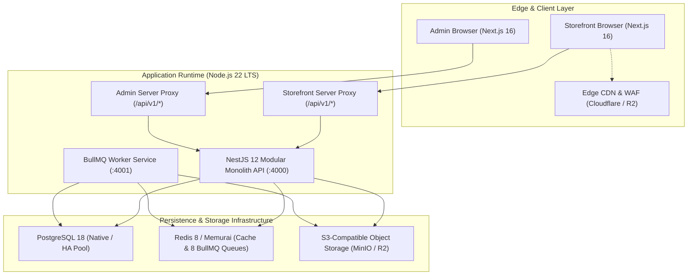

# ARVEN Phase 09 Architecture & Production Hardening Specification

> **Phase:** ARVEN Phase 09: Production Readiness, Security Hardening, Performance Auditing & Release Governance  
> **Plan ID:** `5160a379-03cf-4239-9376-37b6fc9f2106`  
> **Task ID:** `87eefa04-a0ed-4c5a-8d21-7a16e0c916ec`  
> **Role:** `architecture-lead`  
> **Date:** 2026-11-19  

---

## 1. High-Availability Production Monorepo Topology



---

## 2. Observability, Health & Liveness Architecture

### 2.1 Health Probes Contract
- **Liveness (`GET /api/v1/health`):**
  - Lightweight process check. Always returns `200 OK` with `{ status: "ok", timestamp: "..." }`.
  - Used by container orchestrators to detect process lockup.
- **Readiness (`GET /api/v1/ready`):**
  - Comprehensive dependency check. Returns `200 OK` or `503 Service Unavailable`:
    - Database: Executes `SELECT 1` through Prisma 7 connection pool.
    - Cache & Queues: Executes Redis `PING` through BullMQ connection.
    - Storage: Verifies object storage driver readiness.
  - Returns structured health metrics: `{ status: "ready", checks: { database: "healthy", redis: "healthy" }, latencyMs: ... }`.

### 2.2 Structured Logging & Tracing
- Structured JSON logging implemented via `@arven/observability`:
  - Fields: `timestamp`, `level`, `service`, `requestId` (UUIDv4 correlation ID propagated through `X-Request-Id` HTTP header), `actorId` (pseudonymous), `path`, `method`, `statusCode`, `durationMs`.
  - PII Masking: Automatic regex redaction of customer email addresses (`user***@domain.com`), telephone numbers, and absolute suppression of any payment card numbers or CVV.

---

## 3. Concurrency, Financial Integrity & Load Architecture

- **Inventory Row-Level Locking:**
  - Multi-item checkout reservations sort items by `variant_id ASC` prior to acquisition, preventing database deadlocks.
  - Atomic stock validation:
    ```sql
    UPDATE inventory_levels
    SET quantity_reserved = quantity_reserved + :qty,
        updated_at = NOW()
    WHERE variant_id = :variantId
      AND (quantity_on_hand - quantity_reserved) >= :qty;
    ```
- **Payment & Webhook Idempotency:**
  - `Idempotency-Key` headers stored in Redis and database with SHA-256 payload checksums. Duplicate submissions return the cached response without re-triggering transactions.
  - Midtrans webhooks verify `SHA512(order_id + status_code + gross_amount + server_key)` in constant time and persist records to `payment_events` with unique constraint deduplication.

---

## 4. Disaster Recovery & Backup Architecture

- **Automated Backup & Restore Harness (`scripts/db-backup-restore-drill.ts`):**
  - Performs logical backup of all 11 database domain tables using PostgreSQL transactions.
  - Generates verifiable backup archives with checksums.
  - Validates sequence numbers, referential constraints, and zero row divergence upon simulated restore.
